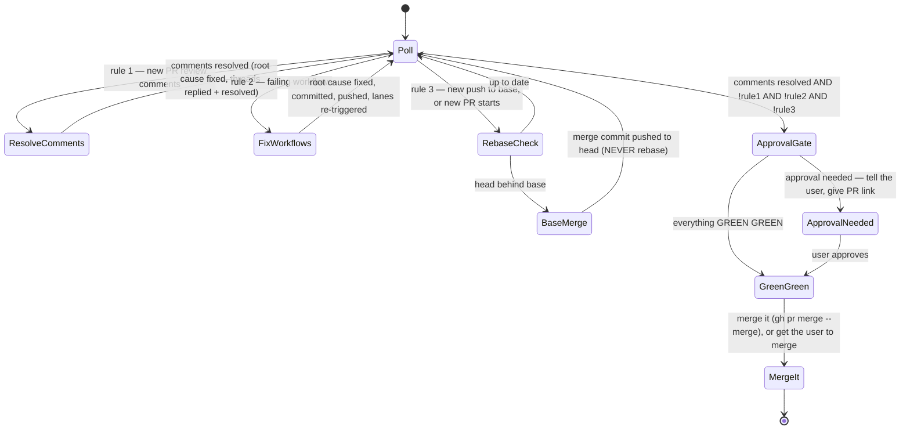

# PR Watch State Machine

**Scope (2026-11-21):** PRs **#651** (`nam/w1-server-linkage`), **#656** (`nam/w1-evidence-agg-fixes`), **#657** (`nam/scorecard-hardening` — merged 6f681ea; its post-merge branch lanes remain in scope).
**Operational rider:** **#658** (`nam/coverage-initial-mismatch`) is the in-flight rule-2 fix for the Code Coverage failure shared by all three PRs' lanes; it is governed by the same machine until merged.

## Diagram

## Rules

| # | Trigger | Action | Restart |
|---|---|---|---|
| 1 | New PR review comments (unresolved threads appear) | `/resolve-pr-comments <n>`: fix each finding at root cause in code, reply to the thread with the fix commit, resolve the thread | back at 0 |
| 2 | Failing workflows on a watched PR or its post-merge branch lanes | `/fix-failing-workflows`: read the failing step's logs, root-cause, fix in the codebase, commit + push (re-triggers lanes); repeat while failures recur | back at 0 |
| 3 | New push to the base, or a new PR starts | Check whether head is behind base (`git log HEAD..origin/base` non-empty) → **merge base into head** (merge commit, signed; never rebase, never squash) | back at 0 |

**Terminal gate:** a PR leaves the loop only when review comments are resolved AND no rule-1/2/3 condition holds.

- **Approval needed** → surface to the user with the PR link (do not silently hold).
- **Everything GREEN GREEN** → `gh pr merge --merge` it, or get the user to merge.

## Standing constraints (how the loop runs here)

- **Merge commits only** — `gh pr merge --merge`; never rebase, never squash, never GitHub's "Update with rebase" (repo directive 2026-09-10).
- **Fort Knox ordering** — on every push: rebase/behind check first, then kilo review comments, and only then wait for the remaining checks.
- **Parallel-session boundary** — #656/#651 belong to the W1 session: base-merge commits (rule 3) are pushed to their heads per this machine, but their review threads are resolved by their owner unless the fix is unambiguous; their PRs are surfaced to the user for merge rather than merged from under them.
- **Shared-worktree hygiene** — every commit uses an explicit pathspec and is verified to contain only this loop's files; base-merges for other PRs happen in a throwaway worktree.
- **No grep-style verification** — a failing lane is "fixed" only when the lane itself goes green on the production path.

## Implementation notes

- The watcher is a sentinel loop: poll every 90 s; exit with a typed trigger (`COMMENTS` / `FAIL` / `BEHIND` / `LANE` / `NEWPR` / `CLEAN` / `SEQUENCE`); the acting agent performs the rule's action and re-arms the sentinel.
- Known-failure memoization: a failure whose root-cause fix is already in flight on an unmerged PR (e.g. #658 for the initial-capture `mismatch` failure) does not re-trigger rule 2; it re-arms once the fix PR merges (then rule 3 brings it into the affected heads).
