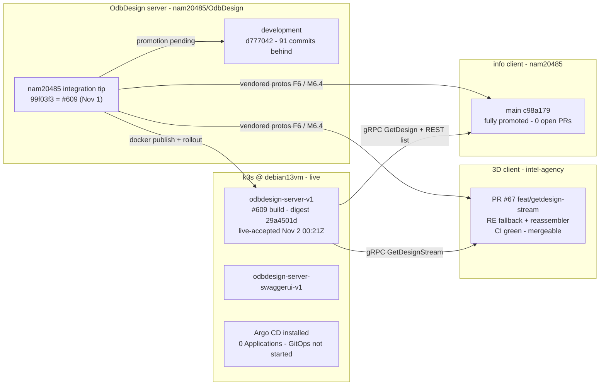
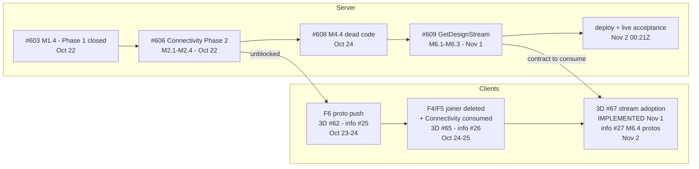
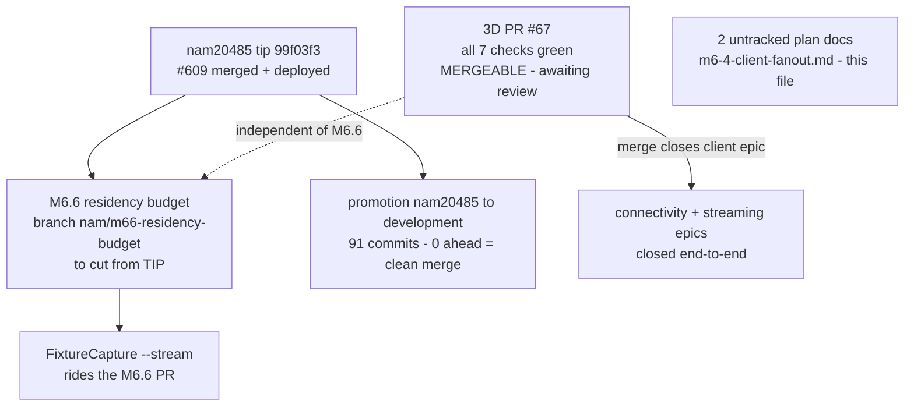
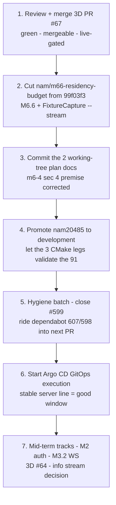

# Program status — server + 3D client + info client (2026-11-01)

| | |
|---|---|
| Purpose | Full status report across the three main projects: what was recently completed, what is in flight, what remains, and what is next — with interleaved diagrams and a dependency-ordered view of all three. Successor to [program-status-2026-10-21.md](program-status-2026-10-21.md); covers the delta since then plus the standing backlog. Itemization level only — execution plans get cut from this, not into it. |
| Verified | 2026-11-01 against origin, all three repos fetched; every PR/issue claim re-checked via `gh`; cluster probed live via `kubectl`. Note the recurring failure mode: the **local server checkout sits on a stale `development`** (91 commits behind) — all server statements below are made against `origin/nam20485`. |
| Repo heads at verification | OdbDesign `origin/nam20485` @ `99f03f3` (#609) · `origin/development` @ `d777042` (91 behind, 0 ahead) · 3D client PR #67 branch `feat/getdesign-stream` @ `2299e6b` · info client `origin/main` @ `c98a179` (fully promoted) |
| Cluster (live probe) | `odbdesign-server-v1` running the **#609 build** — `ghcr.io/nam20485/odbdesign@sha256:29a4501d…` (= `nam20485-1287`), pod started 2026-11-02T00:21Z, live-accepted (streams OK, 3.31 GiB HWM; over-budget monolithic = clean `RESOURCE_EXHAUSTED`). SwaggerUI deployment alongside. Argo CD installed 56d, **zero Applications** — GitOps execution not started. |

## TL;DR

- **The entire 2026-10-21 "NEXT" gate list landed in ten days.** Connectivity Phase 1 closed (#603), Phase 2 shipped (#606), both clients consumed it (F4/F5 + F6 protos), dead code fell (#608), and the GetDesign OOM got its durable fix — **#609 `GetDesignStream` merged 2026-11-01, deployed to k3s the same night, live acceptance passed.**
- **3D client**: the last epic piece — stream adoption (M6.4) — is **PR #67: implemented, 1243/1243 tests, all 7 CI checks green, MERGEABLE**. One review + merge away from closing the client side of the epic.
- **Info client**: fully current — M6.4 proto sync merged and promoted all the way to `main` (#27→#28→#29, 2026-11-02T00:42Z). Zero open PRs. One stale-premise finding: it *does* have a gRPC design-read consumer, so it still needs a stream fallback for the two big designs (see §4.3).
- **Server**: nothing mid-flight in PRs; **M6.6 (residency budget) is queued** to be cut from the #609 tip. The real debt is **promotion debt**: `nam20485` holds 91 commits `development` has never seen.
- **Recommended immediate sequence**: merge #67 → cut M6.6 → commit the two working-tree docs → promote `nam20485`→`development` → close #599 + batch dependabot.

### At a glance

| Component | Recently completed | In flight | Headline remaining |
|---|---|---|---|
| **Server** (`nam20485/OdbDesign`) | #603, #606, #608, #609 (+ follow-ups, CI repairs), #599 test fix, #609 deploy + live acceptance | M6.6 queued; 2 docs uncommitted; 91-commit promotion debt | M6.6 → auth track (M2) → WS events (M3.2) → Argo CD execution → IPC-2581 |
| **3D client** (`intel-agency/odbdesign-3d-client-prototype`) | #62 (protos + CI decoupling), #63 (secret-scan stack), #65 (Connectivity), #67 implemented | **PR #67 open — green, mergeable, unreviewed** | merge #67 · #64 mirrored silkscreen · #11 hit-testing |
| **Info client** (`nam20485/Odbdesign-info-client-india79-b`) | #25, #26, #27 merged; promoted to `main` via #28/#29 | — (clean) | stream fallback decision · stale-epic triage |

---

## Ecosystem map

Everything flows from the server's `nam20485` tip: it publishes the container the cluster runs, and it owns the protobuf contracts both clients vendor. The two dashed dependencies to fix next are the broken promotion link (`nam20485`→`development`) and #67.

---

## 1. Recently completed (delta since 2026-10-21)

The 2026-10-21 status ended with one gate: *"merge #603 → execute M2.1–M2.4 → push protos to both clients (F6) → client F4/F5s."* All of it landed, plus the streaming epic that was then only a parallel-track bullet ("GetDesign OOM on 200-40628 / 350-41017").

### 1.1 Server — `nam20485/OdbDesign`

| Item | Detail |
|---|---|
| **#606 — Connectivity Phase 2** (Oct 22) | `connectivity.proto` (field 12 on `Design`) + always-on server-side derive, $NONE$/−1 absorbed into `Connection.Kind` server-side, warm-path cache assertion, size gates (≤150 KB on `sample_design`, ≤10% fileModel legacy). This was THE client-unblocking gate. |
| **#603 — M1.4** (Oct 22) | Deleted the never-populated `componentRecordsByName`; closed connectivity Phase 1. |
| **#608 — M4.4** (Oct 24) | Deleted dead `BuildPlacementsFromEdaDataFile`. |
| **#609 — GetDesignStream M6.1–M6.3** (Nov 1) | The durable OOM fix: chunked `GetDesignStream` + `DesignChunk` wire contract; size-threshold dispatch guard (`RESOURCE_EXHAUSTED` on over-budget monolithic `GetDesign`); disk-spool warm cache replacing the hot path for big designs. Survived a full three-lens review round (5ebbb7c) plus follow-up fixes (spool durability, generation monotonicity, TOCTOU, last-wins collisions — 14ef083) and an F9 root-cause hunt that ended in a heap-trim guard with the warm-RSS gate 5/5 green (ae1f159). Wire-equivalence proven under deterministic serialization (protobuf map order is randomized per instance). |
| **CI repairs on the line** | macos-14→macos-15 runner rename, Windows orphan-tolerant corruption gate, coverage-build timeout (a056d5f); AGENTS.md required-checks table corrected (de306e1). |
| **#599 — test-side fix** | StepHdr protobuf-Map `find()` flake replaced with linear scan (6a8bfd1); rode the #609 line. **Issue #599 can be closed.** |
| **Deploy chain for #609** | Docker publish (`nam20485-1287`) → `kubectl rollout restart` → live acceptance: streaming works at 3.31 GiB HWM; big-design monolithic requests now fail *clean* instead of OOM-killing the pod. |

### 1.2 3D client — `intel-agency/odbdesign-3d-client-prototype`

| Item | Detail |
|---|---|
| **#62 — F6 protos + CI hardening** (Oct 23) | Vendored protos refreshed (Connectivity lands); coverage decoupled from cross-job artifacts and artifact-upload failures fail the job again (887ace7) — reaction to the intel-agency org's unreliable artifact storage. |
| **#63 — secret-scan stack** (Oct 24) | gitleaks gate + pre-commit + trufflehog weekly sweep, with the five pre-gate history findings baselined in `.gitleaksignore`. |
| **#65 — F4/F5** (Oct 25) | Private netlist joiner deleted; components indexed by refDes from server `Connectivity` (conformance rule 1). |
| **#67 — M6.4 stream adoption** (implemented Nov 1, **open**) | `ResourceExhausted` from monolithic `GetDesign` → single fallback to `GetDesignStream` → chunk reassembler (iterative map resolution per the #599 landmine; server decides, client never guesses size). Wholesale proto sync (kills cosmetic drift; brings the `edaDataFile` `id` fields). Suite 1243/1243; live stream≡monolithic equivalence gate passed against the merged-tip server. |

### 1.3 Info client — `nam20485/Odbdesign-info-client-india79-b`

| Item | Detail |
|---|---|
| **#25 — F6 protos** (Oct 24) | Connectivity contract vendored. |
| **#26 — F4/F5** (Oct 24) | Joiner deleted, `Connectivity` consumed — same shape as 3D #65. |
| **#27 — M6.4/F6 protos** (Nov 2) | `GetDesignStream` + `DesignChunk` contract vendored. Verified: `componentRecordsByName` references exist only in regenerated `obj/` code — no hand-written consumers, so the sync was code-fallout-free. |
| **#28 / #29 — full promotion** (Nov 2 00:42Z) | `nam20485` → `development` → `main`. The info client is **fully current with zero open PRs** — the only repo of the three with no promotion debt. |

---

## 2. In progress / actively being worked

**Nothing is blocked or red right now** — every in-flight item is waiting on a human action (review, merge, cut, commit), not on a fix:

1. **3D PR #67 (the hot item)** — implemented 2026-11-01, all CI green (ubuntu/windows build, coverage, OS matrix, gitleaks, nuget), MERGEABLE, base `development`, no review yet. Merging it closes the client side of both epics. *Note: intel-agency Actions randomly cancels runs — rerun before re-diagnosing any "failure."*
2. **M6.6 — multi-design residency budget (queued, next server PR)** — cut `nam/m66-residency-budget` from `99f03f3` per [getdesign-streaming-oom-plan.md](getdesign-streaming-oom-plan.md) §M6.6: re-base cache charges from file size to a resident estimate (`kResidencyFactor` ≈ 5.0, calibrated from the 4.1–4.4× parse-RSS/wire measurements); `FixtureCapture --stream` rides the same PR. M6.7 (parse-footprint reduction) is explicitly *out* of scope.
3. **Working-tree docs (this repo)** — `docs/plan/m6-4-client-fanout.md` and this file are untracked; both belong on the `nam20485` line. The m6-4 §4 stale-premise correction has been applied in place (see §4.3 below) — both docs are commit-ready.
4. **Promotion debt** — `origin/development` is 91 commits behind `nam20485` (0 ahead — clean merge). That pile contains the entire connectivity epic, streaming epic, and the CI repairs. Nothing has flowed down the `development → staging → main → release` chain recently.

---

## 3. Remaining work (backlog, by component)

Not execution plans — candidate work items, in rough priority order within each component.

### 3.1 Server

| # | Item | State / gate |
|---|---|---|
| 1 | **M6.6 residency budget** (+ `FixtureCapture --stream`) | queued — branch to cut from `99f03f3` |
| 2 | **Promotion chain** `nam20485`→`development`→`staging`→`main`→`release` (+ docker publish of a development-based image) | 91 commits pending; development's strict required checks (3 CMake legs, SBOM, Codacy, dependency-review) gate it |
| 3 | **REST big-design guard (decide)** | The over-budget dispatch guard exists **only on the gRPC path** (`OdbDesignServiceImpl.cpp:276`). REST `GET /designs/<name>` (`DesignsController.cpp:67`) serializes whatever the cache holds — cache byte-budgets apply, but there is no per-request over-budget refusal. M6.6 is the durable fix; decide whether REST also gets a guard/413 or is documented unsupported for the big two. |
| 4 | **Auth track** (server-issues M2.1–M2.5): stopgap Basic → Keycloak → JWT middleware + gRPC interceptor → ownership/device-flow → remove Basic | planned, not started; issues #504/#505 open |
| 5 | **WebSocket `/events`** (server-issues M3.2) | planned, not started |
| 6 | **SI19 item 1.3** — arena allocation in streaming RPCs | descoped from M1.4; *more* relevant now that #609 made streaming a first-class path |
| 7 | **Argo CD GitOps execution** — Applications, `bump-manifest` CI job, CI-gating debt | plan merged (#568); execution never started; would retire the manual deploy chain |
| 8 | **IPC-2581 import** | three planning docs exist (incl. a client migration guide describing an API that does not exist yet); work not started |
| 9 | **M1.5 designs-dir watcher** (optional) · **M6.7 parse-footprint reduction** (deferred, wire-dangerous — needs lazy re-hydration design) | explicitly optional/deferred |
| 10 | **Hygiene** — close #599 (fix merged); dependabot backlog #607 (vcpkg 2026.10.16), #598 (debian base), older actions bumps #510–#513/#467; stale PR #423 (delete-design, vs issue #417); old backlog issues (#473 quick-start, #352 build time, #248 ODB++ writer, #35 Process XML…); dormant PCB-Viewer-frontend epic #440–#447 | batch per the minimize-PR directive |

### 3.2 3D client

| # | Item | State / gate |
|---|---|---|
| 1 | **Merge #67** | the only gate; then promote `development`→`main` per repo flow |
| 2 | **#64 — mirrored silkscreen on Turbot** (top + bottom) | filed Oct 24 with staged evidence; needs a repro-driven root cause (same family as the #53/#55/#57 chirality bugs) |
| 3 | **#11 — hit testing & selection on board features** | standing backlog feature |
| 4 | F7b judgment call — `ComponentInspectorViewModel`'s `OrdinalIgnoreCase` net lookup vs the builder's `Ordinal` | one small decision + doc line |
| 5 | Environment: intel-agency **Enterprise trial window — cancel by ~Nov 19** (day 27 from Oct 23); artifact storage unreliable (already worked around); random run cancels | operational, not code |

### 3.3 Info client

| # | Item | State / gate |
|---|---|---|
| 1 | **GetDesignStream adoption decision (see §4.3)** — the m6-4 plan deferred it on a stale premise; the info client *does* read designs over gRPC and will get a clean `RESOURCE_EXHAUSTED` (no fallback) on the two big designs against any post-#609 server | needs a product decision: mirror the #67 fallback+reassembler, or declare big designs out of scope |
| 2 | **Stale-epic triage** — issues #3–#8 (phase epics) and #10 (REST JSON deserialization) predate the #22/#23 rebuild and are largely superseded | close or rewrite as current-state backlog |
| 3 | F7a doc correction — the "four case-fold sites" plan text vs the actual six | rides the next docs pass |

### 3.4 Cross-cutting

- **Promotion asymmetry**: both clients sit on their trunks; the server trunk (`nam20485`) is 91 commits ahead of `development`. Until promoted, everything since late September exists only on the integration branch and in the `nam20485-latest` container tag.
- **Deploy tooling**: manual `kubectl rollout` + `deploy.ps1` remains the mechanism; Argo CD execution (§3.1 #7) is the structural fix.
- **Proto distribution**: still manual by design (D7) — server pushes refreshed protos per client; the durable fix (shared `odbdesign-model-libs` repo) remains a future idea.

---

## 4. Recommended next steps

1. **Merge 3D PR #67** — it is the only open item on the critical path and closes both epics client-side. (Watch for org-CI cancels; rerun, don't diagnose.)
2. **Cut and execute M6.6** — `nam/m66-residency-budget` from `99f03f3`; residency budget + `FixtureCapture --stream`. While in there, take the §3.1-#3 REST-guard decision (even if the answer is "document unsupported").
3. **Commit the plan docs** — m6-4-client-fanout.md (§4 premise corrected in place, §4.3 below) and this file.
4. **Promote `nam20485` → `development`** — clean merge (0 ahead), then let the strict check gate run; schedule the rest of the chain (`staging`→`main`→`release` + a development-based docker publish) deliberately rather than letting the `nam20485-latest` tag keep being the only thing deployed.
5. **Hygiene batch** — close #599; fold dependabot #607/#598 into the next PR (or one small chore PR), per the minimize-PR-count directive.
6. **Start Argo CD GitOps execution** — the server line is stable and the cluster is freshly deployed; the [execution plan](argocd-deployment-plan.md) is already merged.
7. **Mid-term**: server-issues M2 auth track (Keycloak first) and M3.2 WS events; 3D #64 silkscreen; info-client stream decision.

### 4.3 Stale premise in m6-4-client-fanout.md §4 — corrected 2026-11-01

The M6.4 plan declared a `GetDesignStream` reader for the info client **out of scope** on the premise *"the info client has no gRPC design-read consumer."* That premise was stale: since #23 (Oct 15), `DesignService` reads designs over gRPC — `GetDesignArchiveAsync` → `IOdbDesignGrpcClient.GetDesignAsync` (`DesignService.cs:413`), with its own doc-comment calling the gRPC `GetDesign` response *"the single content source."* REST remains for the design list and auth. Practical effect: on any post-#609 server the info client gets a clean `RESOURCE_EXHAUSTED` that it silently swallows — `FetchDesignArchiveAsync`'s catch-all logs a warning and returns `null` (`DesignService.cs:429-434`) — so a big design renders empty with no user-visible error. **The correction is applied in the m6-4 doc itself** (§2 recon bullets corrected, §4 rewritten as the executed record + owed fallback), so the deferral now reads as remaining work rather than dead-code avoidance.

---

## Appendix — verified state snapshot (2026-11-01)

| What | Value |
|---|---|
| Server open PRs | 9 — 8 dependabot (#607, #598, #513, #512, #510, #520, #467) + stale #423; **zero human feature PRs** |
| Server open issues | 38, dominated by old backlog; active ones: #599 (closeable — fix merged via #609 line) |
| 3D client open PRs | 1 — **#67** (green, mergeable, unreviewed) |
| 3D client open issues | 2 — #64 (mirrored silkscreen), #11 (hit testing) |
| Info client open PRs | 0 |
| Info client open issues | 8 — stale phase epics #3–#8, #2, #10 |
| Cluster | `odbdesign-server-v1` 1/1 Running @ `sha256:29a4501d…` (#609 build, `nam20485-1287`), pod start 2026-11-02T00:21Z; swaggerui 1/1; Argo CD 1/1 everywhere, no Applications |
| Local working trees | Server: `development` (stale) + 2 untracked docs · 3D: on `feat/getdesign-stream`, clean · Info: `nam20485`, clean |
| Branch debt | Server `development` 91 behind `nam20485`; ~20 stale `dev/*` branches on the 3D client |
