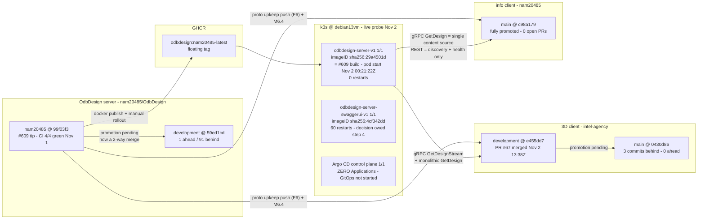
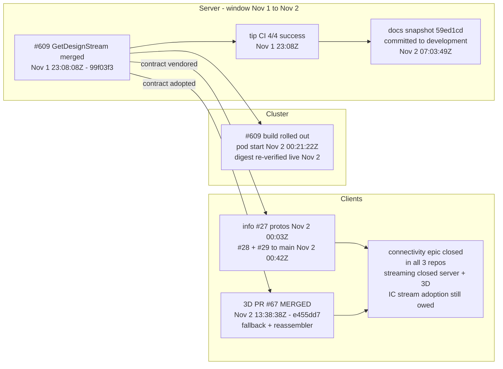
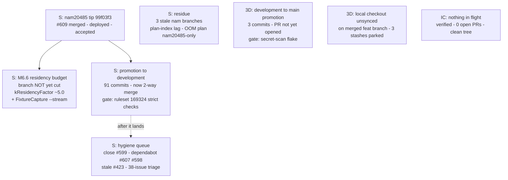

# Program status — server + 3D client + info client (2026-11-02)

| | |
|---|---|
| Purpose | Full status report across the three main projects: recently completed, in flight, what remains, and one dependency-ordered action plan interleaving all three. Successor to [program-status-2026-11-01.md](../completed/program-status-2026-11-01.md); covers the delta since then plus the standing backlog. Itemization level only — execution plans get cut from this, not into it. |
| Verified | 2026-11-02 against origin, all three repos fetched (`--prune`) first; PR/issue claims re-checked via `gh`; cluster probed live and **read-only** via `kubectl` (context `k3s-debian13vm`). Line-level cites re-read locally this session: [m6-4-client-fanout.md](m6-4-client-fanout.md), [README.md](README.md), info-client `DesignService.cs` / `service.proto` / `IOdbDesignRestApi.cs` / `ConnectionService.cs`, 3D `new-issues-remaining.md` / `mirrored_text/ANALYSIS.md` / `packaging-and-release-plan.md` / `opt/client-grpc-optimization-remaining-work.md` §4. Also run this session: a `REST-first` claim sweep across all three repos, `git check-ignore` on the info client's `obj/` codegen, `git stash list` (3D), and `git status --porcelain` re-checks. **No builds or tests were run — read-only scans.** |
| Repo heads at verification | Server: `origin/development` @ `59ed1cd` (local checkout = tip, clean **at scan time** — this document itself is now that tree's sole untracked file; see "own landing" before §4) · `origin/nam20485` @ `99f03f3` (91 ahead / 1 behind) · `staging` @ `9748709` · `main` @ `6074592` · `release` @ `33448b5` (down-chain frozen since mid-September). 3D: `origin/development` @ `e455dd7` (PR #67 merge) · `origin/main` @ `0430d86` (3 behind, 0 ahead). Info: `origin/main` @ `c98a179` — fully promoted. |
| Cluster (live probe) | k3s `debian13vm` reachable; **18/18 deployments READY 1/1** across 6 namespaces. `odbdesign-server-v1` pod on imageID `sha256:29a4501d…` — the digest the predecessor verified as the **#609 build** (`nam20485-1287`), pod start 2026-11-02T00:21:22Z, 0 restarts. SwaggerUI pod up since 2026-08-20 with **60 restarts** (last 3d18h ago — investigate-or-waive decision owed, §4 step 4). Argo CD control plane healthy (6 deployments, 56d old) — **zero Application CRs cluster-wide**; GitOps execution not started. |

## TL;DR

- **The streaming epic is now closed server-side and in the 3D client — the info client still owes stream consumption.** 3D **PR #67 merged 2026-11-02T13:38:38Z** (`e455dd7`) — `ResourceExhausted` fallback + chunk reassembler, 6 checks SUCCESS + trufflehog SKIPPED by design. With server #609 (merged Nov 1 23:08Z, deployed, live-accepted) and the info client's contract sync (#27, promoted to `main` Nov 2 00:42Z), the **connectivity epic is finished in all three repos** and streaming is finished server-side and in the 3D client — the info client holds only the vendored contract (zero hand-written consumers), so its two big designs still render silently empty on the live #609 server until §4 step 5. The predecessor's #1 next step is done.
- **The program docs landed — on the wrong line.** `59ed1cd` committed the 2026-11-01 snapshot + the m6-4 fan-out plan straight to `development` (2026-11-02T07:03:49Z), resolving the predecessor's "2 untracked docs" item but making `development` **1 ahead / 91 behind** — the pending promotion is now a **two-way merge**. This document's own landing instruction is stated before §4: the `nam20485` line, before the promotion.
- **3D client** is 3 commits from fully current: `development`→`main` promotion is the only pending action; zero open PRs. **Info client** fully promoted, zero open PRs, **nothing in flight (verified, not assumed)**.
- **Server headline debt is promotion debt**: 91 commits on `nam20485` unseen by `development`; `staging`/`main`/`release` frozen since 2026-09-14 / 2026-09-08. M6.6 (residency budget) is queued with **no branch cut yet**. Nothing human is mid-flight in PRs (8 open = 7 dependabot + stale #423).
- **Info-client transport truth, code-cited (recorded per that repo's scan requirement)**: gRPC `GetDesign.FileModel` is the single content source for all twelve data tabs (`DesignService.cs:18-32`); REST is discovery + health only (`IOdbDesignRestApi.cs:23-47`); per-resource REST projections were deleted by decision D5. On the live #609 server, the info client silently swallows `RESOURCE_EXHAUSTED` on the two big designs (`DesignService.cs:429-434`).
- **Cluster healthy but pre-GitOps**: server runs the #609 build (digest re-verified live today); SwaggerUI has 60 restarts with no recorded cause (watch item — investigate or waive, §4 step 4); Argo CD installed with zero Applications.

### At a glance

| Component | Recently completed | In flight | Headline remaining |
|---|---|---|---|
| **Server** (`nam20485/OdbDesign`) | #609 merged + tip CI 4/4 green; #609 deployed + live-accepted; docs snapshot committed to `development` (`59ed1cd`) | M6.6 queued (branch not cut); 7 dependabot + stale #423 open; branch residue + plan-index lag | 91-commit promotion `nam20485`→`development` (two-way now) → resume frozen chain; M6.6; hygiene (#599, 7× dependabot, SwaggerUI watch); Argo CD execution |
| **3D client** (`intel-agency/odbdesign-3d-client-prototype`) | **PR #67 MERGED** (Nov 2 13:38Z) — stream adoption, review-complete | `development`→`main` promotion pending (PR not yet open); local checkout unsynced | promote to `main` · NI24 headless stall · #64 Turbot silkscreen · R-2/R-5/R-6/R-7 perf re-measure · packaging decisions |
| **Info client** (`nam20485/Odbdesign-info-client-india79-b`) | #27 + #28 + #29: M6.4 protos vendored and promoted to `main` (Nov 2 00:42Z) | — (verified: nothing in flight) | GetDesignStream adoption decision (big designs render silently empty today) · stale epics #2–#8 + #10 triage · proto-drift guard |

---

## Ecosystem map

Everything still flows from the server's `nam20485` tip: it publishes the container the cluster runs and owns the protobuf contracts both clients vendor. The broken links to fix are the two promotion edges (`nam20485`→`development` in the server, `development`→`main` in the 3D client) and the missing Argo CD Applications.

Shorthand used above and below: **F6** = the clients' proto-upkeep follow-up — the vendored `protoc/` refresh pushed from the server repo (item F6 of the F1–F7 client backlog defined in `component-connectivity-client-followups.md`); **M6.x** = milestones of the GetDesign-streaming OOM plan; **SI19** = server-issues item 19.

---

## 1. Recently completed (delta since 2026-11-01)

The predecessor ended with: *"merge #67 → cut M6.6 → commit the two working-tree docs → promote `nam20485`→`development` → close #599 + batch dependabot."* One day later: **#67 merged, the docs committed (to the wrong line)** — everything else is still queued.

### 1.1 Server — `nam20485/OdbDesign`

| Item | Detail |
|---|---|
| **#609 `GetDesignStream` (M6.1–M6.3) merged** — 2026-11-01T23:08:08Z (`99f03f3`) | Chunked `GetDesignStream` + `DesignChunk` contract, `RESOURCE_EXHAUSTED` dispatch guard on over-budget monolithic `GetDesign`, disk-spool warm cache. Follow-ups rode the trunk: review fixes `5692a4f`/`a205258`/`14ef083`, F9 heap-trim root cause `ae1f159` (warm-RSS gate 5/5), `FeatureGroupRecord` field-2 fix `cc3667a`. Window-edge event already recorded by the predecessor; the delta is its aftermath, below. |
| **Tip CI fully green** | 4/4 workflows success at 2026-11-01T23:08Z on `99f03f3` (CMake-Multi-Platform, Code Coverage, CodeQL, SBOM) — de-risks the 91-commit promotion: the gate is process, not code. |
| **#609 deployed + live-accepted** | Published as `nam20485-1287`; the running pod (start 2026-11-02T00:21:22Z, imageID `sha256:29a4501d…`, 0 restarts) was **re-verified live by today's probe**. The live-acceptance result itself (streams OK at 3.31 GiB HWM; over-budget monolithic = clean `RESOURCE_EXHAUSTED`) is quoted from [program-status-2026-11-01.md](../completed/program-status-2026-11-01.md) line 8 — not re-run in this scan. |
| **Program docs committed — to `development`** | `59ed1cd` (2026-11-02T07:03:49Z) landed `program-status-2026-11-01.md` (229 lines) + `m6-4-client-fanout.md` (63 lines, 292 insertions total) straight on `development`, not the recommended `nam20485` line → `development` is now **1 ahead / 91 behind**. This is the mistake the successor must not repeat — see "own landing" before §4. |
| **Dependabot churn** | Open dependabot PRs dropped 8→7 since 2026-11-01; the closed one was not identified (closed-PR list checked to depth 8 showed only work PRs). |

### 1.2 3D client — `intel-agency/odbdesign-3d-client-prototype`

| Item | Detail |
|---|---|
| **PR #67 — M6.4 GetDesignStream adoption MERGED** — 2026-11-02T13:38:38Z (`e455dd7`, base `development`) | `ResourceExhausted` from monolithic `GetDesign` → single fallback to `GetDesignStream` → chunk reassembler (server decides, client never guesses size). Commits `2299e6b` + `6dd8592` with all 9 unique three-lens review findings fixed (13 reported → 9 unique; suite **1248/1248** post-fixes per [m6-4-client-fanout.md](m6-4-client-fanout.md) status row). Checks: 6 SUCCESS + trufflehog SKIPPED by design. Upstream `feat/getdesign-stream` deleted after merge. This **closes the streaming epic in the 3D client**. |
| **Posture after #67** | `development` = `main` + 3 commits (`2299e6b`, `6dd8592`, merge `e455dd7`); `development..main` = 0 → clean promotion. Zero open PRs; the last 15 workflow runs all success, zero cancellations. |

### 1.3 Info client — `nam20485/Odbdesign-info-client-india79-b`

| Item | Detail |
|---|---|
| **M6.4 chain fully promoted** — completed 2026-11-02T00:42:05Z | #27 (vendored `GetDesignStream`/`DesignChunk` contract, `protoc/grpc/service.proto:35` and `:146-148`) merged to `nam20485` 00:03:31Z → #28 to `development` 00:12:52Z → #29 to `main` 00:42:05Z (`c98a179`). Already known to the predecessor; **re-verified in this scan**: zero open PRs, clean checkout on `nam20485` @ `8679ac8`, and `origin/main..origin/nam20485` = 0 (the 4-commit reverse drift is promotion merge commits only — nothing stranded). |
| **Contract status** | Vendored but unconsumed: zero hand-written references. `git grep GetDesignStream -- 'src/*.cs' 'tests/*.cs'` → **0** — git grep searches **tracked files only**, and the generated grpc codegen lives under git-ignored `obj/` (`git check-ignore` → `.gitignore:32 [Oo]bj/`, verified this session). A literal filesystem grep (`grep -rn GetDesignStream src tests --include=*.cs`) finds exactly **6 lines, all generated codegen** in `src/OdbDesign.ProductModel/obj/Debug/net10.0/grpc/ServiceGrpc.cs`. `ConnectionService.cs:67` still calls unary `GetDesignAsync` (100 MB `MaxReceiveMessageSize` at `:187`). Adoption is the open item (§3.3). |

### 1.4 Cross-cutting

- **Epic end-state, precisely**: connectivity is closed in **all three** repos (server #606 line, 3D #65, info #26); streaming is closed **server-side (#609) and in the 3D client (#67)** — the info client carries only the vendored contract (#27) and owes stream *consumption* (§4 step 5). No other epic work is outstanding anywhere.
- **The guard is now production behavior**: the cluster runs the #609 build, so over-budget monolithic `GetDesign` fails clean — the 3D client handles it (fallback); the info client swallows it (§3.3).
- **Promotion asymmetry persists**: server 91-commit debt (plus 1 reverse commit), 3D 3-commit debt, info clean.

---

## 2. In progress / actively being worked

Nothing is blocked or red — every item waits on a human action (cut, merge, open-PR, triage), not on a fix.

### 2.1 Server

| Item | State / gate |
|---|---|
| **M6.6 residency budget — queued, branch not cut** | Next server PR per [m6-4-client-fanout.md](m6-4-client-fanout.md) §5 and the predecessor §2: re-base cache charges from file size to a resident estimate (`kResidencyFactor` ≈ 5.0) + `FixtureCapture --stream`. No `nam/m66-residency-budget` branch exists on origin. *Gate: nothing — cutting from `99f03f3` is the first action.* (The spec doc `getdesign-streaming-oom-plan.md` exists only on `nam20485` and was not read in this scan — scope here follows the docs that succeeded it, the m6-4 fan-out plan §5 and the predecessor status §2.) |
| **Open PRs: 8 = 7 dependabot + 1 stale** | #607 (vcpkg 2026.10.16, updated 2026-10-24), #598 (debian base), #520/#513/#512/#510 (actions bumps), #467 (upload-pages-artifact), plus stale #423 (wen2so 2025-08, delete-design vs issue #417). **No human feature PR is open — the trunk is quiet.** *Gate: human batching decision under the standing minimize-PR-count directive (the directive's canonical location is not recorded in the scan).* |
| **Branch residue** | `nam/getdesign-stream` @ `de306e1` fully merged (verified ancestor of `99f03f3`) but un-deleted; `nam/unified-model` (2026-08-30) and `nam/unified-clang-build` (2025-12-27) each hold exactly 1 unmerged commit. *Gate: cleanup triage.* |
| **Plan-index lag** | [README.md](README.md) (in-flight index, updated 2026-11-01 — re-read locally this session) references none of `program-status-2026-11-01.md`, `m6-4-client-fanout.md`, or `getdesign-streaming-oom-plan.md`; the OOM plan is absent from `development` entirely. *Gate: next docs pass.* |

### 2.2 3D client

| Item | State / gate |
|---|---|
| **`development`→`main` promotion of #67's 3 commits** | The only near-term open work item; PR not yet opened (same shape as promotions #61/#44/#37). *Gate: the secret-scan gate flaked on #62/#63/#65 and needed retrigger pushes (`de88ed1`, `3f9c227`, `7187a8b`) — rerun on "Failed to complete secret scan"; never read a cancelled run as red.* |
| **Local checkout unsynced** | On `feat/getdesign-stream` @ `6dd8592` whose upstream was deleted after merge (0 unique commits vs `origin/development`); local `development` stale at `0430d86` (3 behind); 3 stashes parked (messages `devopt` on `dev/opt`, `diags` on `devopt/grpc-diag`, `changes` on `planpart2/render-components-finish` — re-checked via `git stash list` this session) — contents not inspected; may hold NI24 diagnostics. |
| **M6.4 post-#67 remainder** | Per [m6-4-client-fanout.md](m6-4-client-fanout.md) §5 (a plan doc **in this repo**, read this session): after #67 the only remainder is the **info-client stream fallback** (§3.3 #1 / §4 step 5), plus server-side M6.6. **Nothing further is owed in the 3D client itself.** |

### 2.3 Info client

- **Nothing in flight (verified, not assumed)** — zero open PRs, no uncommitted or untracked plan docs, clean tree; the F2–F6/M6.4 chain is fully merged and promoted to `main` as of 2026-11-02T00:42Z.

### 2.4 Cross-cutting

- **Promotion asymmetry**: server `development` 91 behind `nam20485` (+1 ahead); 3D `main` 3 behind `development`; info clean. Everything server-side since late September exists only on the integration branch and the `nam20485-latest` container tag.
- **SwaggerUI restart count (watch item)**: 60 restarts since 2026-08-20, last 3d18h before the probe — the pod may still be cycling, and no cause is recorded in the scan. Decision owed: investigate (pod events/logs) or explicitly waive — §4 step 4.
- **Deploy tooling**: still the manual `deploy.ps1`/`kubectl` chain — the structural fix is Argo CD execution (§4 step 6).

---

## 3. Remaining work (backlog, by component)

Not execution plans — candidate work items, in rough priority order within each component.

### 3.1 Server

| # | Item | State / gate |
|---|---|---|
| 1 | **Promotion debt (the headline)** — 91 commits on `nam20485` never seen by `development`; `staging` frozen since 2026-09-14, `main`/`release` since 2026-09-08 | development strict checks (ruleset 169324: 3 CMake legs, SBOM, Codacy, dependency-review, **1 approval**); 169360 bases need `--admin` merges. The 1 approval has the same solo-maintainer question as 169360's approvals — see §4 step 2 |
| 2 | **M6.6 residency budget** + the **REST big-design guard decision** — the dispatch guard exists only on the gRPC path (`OdbDesignServiceImpl.cpp:276` per predecessor §3.1-#3); REST serializes whatever the cache holds | M6.6 cut from `99f03f3`; guard decision rides the same PR |
| 3 | **Auth track M2.1–M2.5** (stopgap Basic → Keycloak → JWT middleware/gRPC interceptor; issues #504/#505) · **M3.2 WebSocket `/events`** · M1.5 designs-dir watcher ([README.md:14](README.md)) | planned, not started; after M6.6 + promotion; Keycloak provisioning |
| 4 | **SI19 item 1.3 — arena allocation in streaming RPCs** ([README.md:17](README.md)), descoped from #587 | post-M6.6 perf work — more relevant now streaming is first-class |
| 5 | **Argo CD GitOps execution** ([README.md:21](README.md); plan merged #568; zero Applications on cluster today) · **IPC-2581 import** ([README.md:23-26](README.md); client guide describes a non-existent API) | stable server line / future feature |
| 6 | **Issue hygiene** — 38 open: #599 closeable (fix merged via `6a8bfd1`); semi-recent #517/#518 (Feb 2026), #504–#506 (Dec 2025); the rest 2025-and-older dormancy (PCB-viewer epics #440–#447, #473, #352, #248) | triage sweep |
| 7 | **Deferred by decision** — M6.7 parse-footprint reduction (wire-dangerous, needs lazy re-hydration design); plan-index README refresh | explicitly deferred / rides M6.6 |

### 3.2 3D client

| # | Item | State / gate |
|---|---|---|
| 1 | **`development`→`main` promotion** (§2.2) | PR open + secret-scan flake management |
| 2 | **#64 — silkscreen mirrored on Turbot** (top + bottom; live bug, open since 2026-10-24, zero comments) | evidence committed at `docs/plan/issues/mirrored_text/turbot_top_sst.png` + `turbot_bottom_ssb.png` (commit `04919d0` — both files verified present locally; these document the bug as filed); same class as the #53 chirality fix; diagnosis additionally needs A/B comparison captures — blocked on capture/evidence tooling (NI24), see §4 step 8 |
| 3 | **NI24 — headless automation stall**: 0%-CPU hang at frame=5/drawCalls=0 under Xvfb, reproduced with mock AND real backends; blocks every `--auto-screenshot` flow (NI23 sweeps, silk A/B for #64) | diagnosis with `dotnet-stack` on the stalled process or `WaitForAsync` timeout logging (`new-issues-remaining.md:5-21`, re-read locally) |
| 4 | **gRPC perf backlog R-2/R-5/R-6/R-7** (NI21 review; the opt doc §4 table, re-read this session): R-2 concurrent symbols prefetch (serial per layer, 7.3 s on rigidflex / 34 layers — cheapest measured win), R-5 streaming stall guard, R-6 concurrent layer streams (stream-wait 69% on rigidflex post-batch), R-7 GC re-check. R-1 and R-4 are **done** (2026-09-21); R-3 is a separate `RequestLoadDesign` proposal item, not part of this perf set | baseline predates M6.4 — re-measure post-#67 before picking |
| 5 | **Packaging & release plan unimplemented** — draft 2026-09-10 (status "Draft for review", verified locally); 0 git tags, no release branch | owner decisions: private-repo Actions billing (macOS 10× multiplier) and the SharpEngine open-source license requiring the repo to be public |
| 6 | **Org operational constraints (current)** — unreliable artifact storage (coverage decoupled from cross-job artifacts in `887ace7`; artifact-upload failures fail the job again in `7d4ce22`, per the owner directive of 2026-10-23 cited verbatim in that commit's message); secret-scan gate flakes; random run cancellations **not in evidence this window** (last 15 runs all success) | operational, not code |
| 7 | **#11 — hit testing & selection** (2026-02-07) — largely delivered via #36/#38 + #19-era work | verify-and-close or retitle |

### 3.3 Info client

| # | Item | State / gate |
|---|---|---|
| 1 | **GetDesignStream client adoption** — contract vendored (`service.proto:35`, `:146-148`) with zero hand-written client references (the only `.cs` hits are git-ignored, generated `obj/` grpc codegen — §1.3); on the live #609 server the two big designs (200-40628, 350-41017) return a clean `RESOURCE_EXHAUSTED` that `FetchDesignArchiveAsync` **swallows** (`DesignService.cs:429-434` — logs a warning, returns null) → design renders empty, no user-visible error | product decision: mirror #67's fallback+reassembler (per [m6-4-client-fanout.md](m6-4-client-fanout.md) §4 — resolve map entries by iteration, never `find()`/`at()`; the **#599 landmine** is the address-layout-dependent protobuf-Map `find()` flake behind server issue #599, fixed server-side by a linear scan in `6a8bfd1` — the same ordering hazard for any client reassembler) or declare big designs out of scope; either way stop nulling genuine transport failures |
| 2 | **Transport-truth correction — satisfied; no standing instance remains.** Corrected in this document (callout below) and in [m6-4-client-fanout.md](m6-4-client-fanout.md) §2 (its own correction note, line 27). A `grep -rn REST-first` sweep run this session across all three repos' `docs/` plus the info client's `src/` found **no other occurrence** — the only hits are the two correction records | none — documentation-only |
| 3 | **#10 obsolete** — asks to implement REST JSON deserialization for components/nets: exactly what decision D5 deleted (`DesignService.cs:27-31`; `docs/connectivity-task.md:16-18`) | maintainer closes as superseded |
| 4 | **Phase epics #2–#8 predate the rebuild — re-triage, don't execute literally**: #5 done (#26); #3/#4/#6 substantially landed (12 tab views, BasicAuthService, connection state machine `ConnectionService.cs:104-278`); #7 pipe client wired into Components/Pins/Nets tab VMs (`CrossProbeService.cs:15-26`) but viewer-side counterpart unverified; #8 partial (#24 harness; no release/packaging) | maintainer re-triage against post-rebuild reality |
| 5 | **Proto refresh manual, no drift check (D7)** — three hand-refreshes already (#23/#25/#27); silent server contract changes surface only at compile or runtime | decision on where a drift check lives (client CI vs server publish) |

> **Transport truth (code-cited; recorded per the info-client scan's explicit requirement).** gRPC `GetDesign.FileModel` is the single content source for **all** design reads — matrix, step headers, EDA data, symbols, components/nets/packages/parts, drill tools (`src/OdbDesignInfoClient.Services/DesignService.cs:18-32` in `nam20485/Odbdesign-info-client-india79-b`; the fetch itself is `DesignService.cs:413`, re-read this session). REST survives only as discovery + health: `/filemodels`, `/filemodels/{name}/steps`, `/healthz/*` (`Api/IOdbDesignRestApi.cs:23-47`). The per-resource REST projections were deliberately deleted per decision D5. The 2026-11-01 lesson's "REST-first; gRPC only for Connectivity" claim is **false in code** — and per the sweep above, no document still asserts it.

### 3.4 Cross-cutting

- **Promotion asymmetry** (§2.4) — the program's largest single debt item.
- **Manual deploy chain** until Argo CD execution lands (§4 step 6).
- **Proto distribution remains a manual push per client (D7)** with no drift check on either side.
- **Org CI friction** concentrated on the 3D side (intel-agency): artifact storage + secret-scan flakes; watch for random cancellations (none observed in the last 15 runs).

---

## 4. Action plan — one ordered sequence across all three projects

```mermaid
flowchart TD
    a1["1 3D: promote development to main\n3 commits - CI already green"]
    a2["2 S: promote nam20485 to development\n91 commits - 2-way merge"]
    a3["3 S: cut + execute M6.6\n+ REST guard decision"]
    a4["4 S: hygiene + cluster watch\n#599 - dependabot x7 - swaggerui"]
    a5["5 IC: GetDesignStream adoption\nfallback or descope"]
    a6["6 S: Argo CD GitOps execution\n0 Applications today"]
    a7["7 3D: fix NI24 headless stall"]
    a8["8 3D: diagnose #64 silkscreen"]
    a9["9 S: resume staging main release chain\n+ dev-based docker publish"]
    a10["10 3D: re-measure then R-2 perf\nR-5 R-6 R-7 follow"]
    a11["11 IC: proto-drift guard"]
    a12["12 IC: stale-issue + branch triage"]
    a13["13 3D: triage #11 - verify and close"]
    a14["14 S: mid-term auth M2 + WS M3.2\n+ SI19 arena item"]
    a15["15 3D: packaging release decisions"]
    a16["16 S: IPC-2581 import - future"]
    a2 -->|"stable line first"| a6
    a2 --> a9
    a3 -->|"perf items build on it"| a14
    a7 -->|"capture evidence"| a8
```

*Discharged in this document:* **[IC]** the transport-truth correction (§3.3 callout) — and the §3.3-#2 sweep confirms no other document still carries the claim, so **no doc sweep remains open**.

***This document's own landing*** — do not repeat the `59ed1cd` mistake (§1.1): land this file on the **`nam20485` line** (branch off `nam20485`, PR into `nam20485`), merged **before step 2's promotion**, so it rides into `development` with the 91 instead of widening the two-way merge as a second straight-to-`development` commit. At scan time the server tree had 0 untracked files; this file is now that tree's **only** untracked file (`git status --porcelain` → `?? docs/plan/program-status-2026-11-02.md`, re-run this session).

1. **[3D] Promote `development` → `main`** — promotion PR for #67's 3 commits (same shape as #61/#44/#37). *Waits on:* nothing technical — the development-merge CI was fully green 2026-11-02T13:38Z; the operational gate is the secret-scan flake (rerun on "Failed to complete secret scan"; never read a cancelled run as red).
2. **[S] Promote `nam20485` → `development`** — 91 commits, now a **two-way merge** (`development` is 1 ahead via `59ed1cd`); carries the connectivity + streaming epics and all CI repairs. *Waits on:* ruleset 169324 strict checks (3 CMake legs, SBOM, Codacy, dependency-review, 1 approval) — tip CI is already 4/4 green, so the risk is the gate, not the code. **Open question to settle before the PR:** 169324's required *1 approval* has the same solo-maintainer problem this doc flags on 169360 (the author cannot approve their own PR); the scan data does not record where that approval comes from or whether step 2 also needs `--admin` — 169360's equivalent is resolved with `--admin`, 169324's path is **not recorded in this scan**.
3. **[S] Cut `nam/m66-residency-budget` from `99f03f3` and execute M6.6** — resident-estimate budget (`kResidencyFactor` ≈ 5.0) + `FixtureCapture --stream`; take the REST big-design guard decision in the same PR (even if the answer is "document unsupported"). *Waits on:* nothing — the branch cut is the first action; lands on `nam20485` and rides the next promotion cycle.
4. **[S] Hygiene + cluster-watch batch** — close #599 (fix merged via `6a8bfd1` on the #609 line); **disposition all seven** open dependabot PRs, not just the two with recorded intent (#607 vcpkg / #598 debian base = fold into the next PR): #520/#513/#512/#510 (actions bumps) and #467 (upload-pages-artifact) need an explicit merge/close/ride call in the same batch — **no disposition for those five is recorded in the scan**; dismiss or restate stale #423; cheap triage sweep of the 38 open issues. **Cluster watch:** decide the SwaggerUI restart count — 60 restarts since 2026-08-20, last 3d18h before the probe, no cause recorded: investigate (pod events/logs for `odbdesign-server-swaggerui-v1-dff4bfc8c-tgv8b`) or explicitly waive, and record the decision here. *Waits on:* human action only.
5. **[IC] GetDesignStream adoption decision + implementation** — mirror #67's fallback+reassembler or declare big designs out of scope; either way stop swallowing genuine failures (`DesignService.cs:429-434`). *Waits on:* a product decision in the info-client repo — the technical gate (server endpoint live) is **satisfied**: the cluster runs the #609 build (today's probe) and the predecessor recorded live acceptance.
6. **[S] Start Argo CD GitOps execution** — Applications per `argocd-deployment-plan.md` (plan merged #568; zero Applications on the cluster today); retires the manual deploy.ps1/kubectl chain. *Waits on:* step 2 landing first is preferable (stable development line); deploy-branch decisions per the plan.
7. **[3D] Fix NI24 headless stall** — `dotnet-stack` on the stalled process per the runbook (`new-issues-remaining.md:20-21`); inspect the 3 parked stashes first (may hold diagnostics — contents unverified). *Waits on:* a local diagnosis session; nothing upstream.
8. **[3D] Diagnose #64 Turbot mirrored silkscreen** — start from the rev-4 numeric methodology in `docs/plan/issues/mirrored_text/ANALYSIS.md`. *Waits on:* fresh **A/B capture evidence** — the committed PNGs (`04919d0`) document the bug *as filed*; the diagnosis needs comparison captures (the "silk A/B" variants the `--auto-screenshot` flow would produce — exactly what NI24 blocks), or manual screenshots in the meantime.
9. **[S] Resume the frozen chain** — `staging` (frozen 2026-09-14) → `main` → `release` (frozen 2026-09-08) + a development-based docker publish. *Waits on:* step 2 landing — per the scan, chain resumption gates on the promotion only. M6.6 is **not** a gate: it lands on `nam20485` (step 3) after the chain resumes and rides the *next* `nam20485`→`development` promotion, so the resumed chain carries today's 91 commits, not M6.6. 169360 bases need `--admin` merges (code-owner + last-push approval unsatisfiable solo).
10. **[3D] Re-measure the post-#67 load profile, then R-2** concurrent symbols prefetch; R-5/R-6/R-7 follow per what the re-measure shows. *Waits on:* the re-measurement — the existing numbers (symbols 7.3 s serial on rigidflex; stream-wait 69%) predate GetDesignStream.
11. **[IC] Add a proto-drift guard** — diff the vendored `protoc/` against the server repo's, in CI. *Waits on:* a decision on where it lives (client CI vs server publish) — D7 currently records "no drift check exists or is planned".
12. **[IC] Stale-issue + branch triage** — #10 close-as-superseded; #2–#8 re-triage against the rebuilt client; delete merged/stale remote branches (`feature/f2-conformance-harness`, `feature/f3-grpc-design-reads`, `feature/phase-3-parity`, `copilot/*`, `mn/droid-app`, `add-factory-workflows-*`). *Waits on:* maintainer decisions only.
13. **[3D] Triage #11** (hit testing/selection) — largely delivered (#36/#38 + #19-era work); verify remaining gaps, then close or retitle. *Waits on:* nothing.
14. **[S] Mid-term tracks** — auth M2.1–M2.5 (Keycloak first; issues #504/#505), M3.2 WebSocket `/events`, SI19 item 1.3 arena allocation in streaming RPCs. *Waits on:* M6.6 + promotion; Keycloak provisioning.
15. **[3D] Decide then execute the packaging/release track** — the plan is fully specified but nothing landed (0 tags, no release branch). *Waits on:* owner decisions — private-repo Actions billing (macOS 10×) and the SharpEngine open-source license requiring a public repo.
16. **[S] IPC-2581 import** — future feature; three planning docs exist, and the client migration guide describes an API that does not exist yet. *Waits on:* upstream prioritization.

---

## Appendix — verified state snapshot (2026-11-02)

| What | Value |
|---|---|
| Server branches | `development` `59ed1cd` (local = origin; clean **at scan time** with 0 untracked files — this document is now that tree's sole untracked file, `git status --porcelain` re-run this session) · `nam20485` `99f03f3` (91 ahead / 1 behind development) · `staging` `9748709` (51 ahead / 8 behind development; frozen 2026-09-14) · `main` `6074592` (2 ahead / 56 behind staging; frozen 2026-09-08) · `release` `33448b5` (2 ahead / 0 behind main) |
| 3D branches | `development` `e455dd7` · `main` `0430d86` (`main..development` = 3: `2299e6b`, `6dd8592`, `e455dd7`; reverse = 0) · local on `feat/getdesign-stream` `6dd8592` (upstream deleted post-merge), clean, 3 stashes (messages `devopt` on `dev/opt`, `diags` on `devopt/grpc-diag`, `changes` on `planpart2/render-components-finish`); local `development` stale 3 behind; **0 tags** |
| Info branches | `main` `c98a179` · `development` `72f700d` · `nam20485` `8679ac8` — `nam20485` ⊆ `development` ⊆ `main` (reverse drift = 4 promotion merge commits only); local `nam20485` clean; stale local `main` (41 behind) and `development` (33 behind) |
| Server open PRs / issues | 8 PRs = 7 dependabot (#607, #598, #520, #513, #512, #510, #467) + stale #423 · 38 issues, only #599 recently updated (2026-10-30; closeable — fix merged via `6a8bfd1`) |
| 3D open PRs / issues | 0 PRs · 2 issues — #64 (mirrored silkscreen, 2026-10-24), #11 (hit testing, 2026-02-07) |
| Info open PRs / issues | 0 PRs · 8 issues — #2–#8 plus #10 (Feb-2026 phase epics, stale vs the rebuild; #9 is not among them) |
| Cluster (read-only probe) | 18/18 deployments READY 1/1 across 6 namespaces (`argocd`, `default`, `kube-system`, `monitoring`, `portainer`, `trivy-system`). `odbdesign-server-v1` 1/1, imageID `ghcr.io/nam20485/odbdesign@sha256:29a4501d0562…`, pod `odbdesign-server-v1-5cc87f5ddc-mxnmb` start 2026-11-02T00:21:22Z, 0 restarts. `odbdesign-server-swaggerui-v1` 1/1, imageID `…swaggerui@sha256:4cf342ddb938…`, pod start 2026-08-20T05:10:23Z, **60 restarts** (last 3d18h before probe; cause not investigated — decision owed, §4 step 4). Argo CD: 6 deployments 1/1 (56d old), **0 Application CRs cluster-wide** (`kubectl get applications.argoproj.io -A` → No resources found) |
| Not verified in this scan | Live streaming behavior of the running server (acceptance quoted from predecessor line 8); the identity of the dependabot PR that closed (8→7); contents of `getdesign-streaming-oom-plan.md` (nam20485-only); the 3 local 3D stashes; runtime/UX state of the info client's 12 tab views; the cause of the SwaggerUI restarts; whether 169324's required 1 approval is satisfiable by a solo maintainer or needs `--admin` (§4 step 2); **no builds or tests executed — all scans read-only** |
