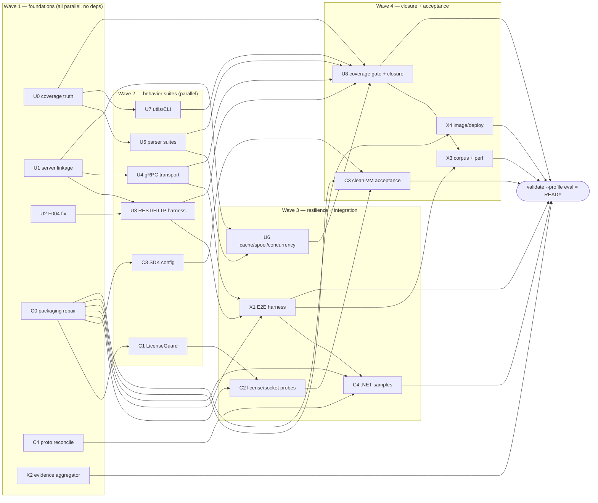

# Development Sequencing & Parallel Delegation Plan

**Date:** 2026-11-20
**Status:** Execution-sequencing analysis (lightweight) — complements, does not replace, the criteria plan
**Companion to:** [`test-coverage-and-evaluation-validation-plan.md`](test-coverage-and-evaluation-validation-plan.md) (the *what*) and [`release-readiness-checker-plan.md`](release-readiness-checker-plan.md) (the *measurement*)

This is the **how / when / in-what-order / what-runs-in-parallel** layer. The criteria plan
says what must be true; this says how to get there efficiently with parallel subagents.

**Acceptance criteria already exist** — every criterion in `release_readiness_criteria.json`
*is* a machine-checkable AC. A phase is "done" when its criteria pass
`release_readiness.py validate`. No separate phase-AC prose is needed.

---

## 1. Work items (the implementable units)

Criteria are grouped into deliverable work items. `U` = upstream OdbDesign, `C` = commercial
overlay, `X` = cross-cutting acceptance. Effort is rough single-engineer days.

| ID | Work item | Depends on | Lane | Est | Checker criteria it satisfies |
|---|---|---|---|---:|---|
| **U0** | M0 truthful coverage: exclude generated, initial+runtime capture, branch coverage, pin test data, `check_coverage.py`, inventory completeness | — | measurement | 3–4 | M0-01/02, enables SRC-01 |
| **U1** | M1 server test linkage: link `OdbDesignServerLib`, drop dup sources/codegen, re-enable batch tests, deterministic seams, test labels/manifest | — | server | 3–5 | M1-01/02/03 |
| **U2** | F004 fail-closed auth fix + real test | — | security | 1–2 | SEC-01/02 |
| **U3** | M2 real HTTP/external-process harness: REST route matrix, upload, auth, ETag/304 | U1, U2 | server | 5–7 | REST-01..04, SEC-03 |
| **U4** | M2 gRPC real-transport: feature streams, batch boundaries, health, contract | U1 | server | 3–5 | GRPC-01..04 |
| **U5** | M3 spec-driven parser suites (StepHdr/Features/EdaData/Components/Matrix/Netlist/MiscInfo/FileArchive) | U0 | parsers | 9–13 | M3-01/02 |
| **U6** | M4 cache/spool/product-model resilience + deterministic concurrency | U1, U5 | resilience | 5–7 | M4-01/02 |
| **U7** | M5 utilities/app-base/CLI/lifecycle tests | U0 | utils | 4–6 | M5-01 |
| **U8** | M6 residual closure + coverage gate + mutation/negative controls + 3-run repeatability | U0,U3,U4,U5,U6,U7 | closure | 4–6 | SRC-01..04 |
| **C0** | Commercial packaging repair + wire LicenseGuard/upstream tests + commercial coverage + secret-free CI | — | commercial | 2–4 + repair | PKG-01, C0-01/02 |
| **C1** | LicenseGuard boundaries + real signer round trips + clock seam | C0 | commercial | 3–5 | LIC-01/02 |
| **C2** | Commercial process/socket probes (license reject, loopback) — extends checker probes | C0, C1 | commercial | 3–5 | LIC-03, LOOP-01 |
| **C3** | Exact-package acceptance: checksum/GPG/SBOM/provenance, `OdbDesignConfig.cmake`, clean-VM SDK consumer, docs | C0, C2 | delivery | 4–7 | PKG-02/03, SDK-01, DOC-01 |
| **C4** | Proto reconciliation + .NET/Blazor samples + real round trips | C0 (samples); proto part: — | client | 4–7 | PROTO-01..03, DOTNET-01/02 |
| **X1** | External-process E2E acceptance harness (upload→load→read→stream→cancel→restart) | U3, U4, C0 | acceptance | 3–5 | E2E-01, RESTART-01, CONC-01 |
| **X2** | Evidence aggregator + `eval-plan.json` manifest + candidate binding | — | acceptance | 2–3 | EVID-01/02 |
| **X3** | Customer-corpus + performance rehearsal (named large designs + customer jobs) | X1, U8, customer data | acceptance | 3–5 + data | CORP-01/02, PERF-01/02 |
| **X4** | Image-digest + deployment acceptance (k3d/k3s, PVC restart) | C0, image publish | deployment | 2–4 | IMAGE-01, K8S-01 |

---

## 2. Parallel dependency graph

Edges point from prerequisite → dependent. Nodes in the same horizontal band have no
mutual dependency and can be delegated to **parallel subagents**.



---

## 3. Waves = parallel subagent delegation batches

Each wave is a set of work items with **no intra-wave dependency**, so they can run as
concurrent subagents. A wave starts when its prerequisites (prior wave) are merged.

| Wave | Parallel subagents | Gate to advance |
|---|---|---|
| **1 — Foundations** | U0 · U1 · U2 · C0 · C4(proto) · X2 — **up to 6 concurrent** | coverage denominator real; server tests link real lib; F004 fixed; commercial package green; protos reconciled; aggregator skeleton |
| **2 — Behavior suites** | U3 · U4 · U5 · U7 · C1 · C3(SDK config) — **up to 6 concurrent** | real REST/gRPC suites pass; parser suites pass; LicenseGuard boundaries pass |
| **3 — Resilience + integration** | U6 · C2 · X1 · C4(samples) — **up to 4 concurrent** | cache/spool/concurrency green; license/socket probes green; E2E harness works; samples run |
| **4 — Closure + acceptance** | U8 · C3(clean-VM) · X3 · X4 — **up to 4 concurrent** | `validate --profile eval` READY |

**Max useful parallelism ≈ 6 subagents** in Waves 1–2, tapering to 4. Beyond that, items
share files or prerequisites and would conflict rather than speed up.

---

## 4. Critical path

The longest dependency chain sets the minimum calendar duration (assuming each wave's
items run in parallel):

```
U1 → U3 → X1 → X3 → DONE        (upstream server → E2E → customer corpus)
U1 → U4 → U6 → U8 → DONE        (upstream server → resilience → coverage gate)
C0 → C1 → C2 → C3v → DONE       (commercial packaging → license → probes → clean-VM)
```

These three chains are roughly equal length (~4 waves). **U1 and C0 are the two pivotal
unblockers** — almost everything downstream waits on one of them. Start U1 and C0 first and
staff them strongest; they gate the most parallel work.

`X3` additionally waits on **customer data** (external dependency) — request the representative
and largest designs early so it isn't the late blocker.

---

## 5. Delegation safety — shared-file contention

Parallel subagents editing the **same file** will conflict. The main contention point:

- **`OdbDesignTests/CMakeLists.txt`** is touched by U1 (refactor), then U3/U4/U5/U6/U7 (each
  adds test sources). **Sequence U1 first** (it owns the refactor), then let Wave-2 agents add
  *separate test files*; coordinate the CMake edits (one agent owns CMake wiring, or split into
  per-suite `.cmake` includes so additions don't collide).
- **`scripts/release_readiness.py` / registry**: C2 extends probes; X2 builds the aggregator.
  Give the checker engine a single owner per wave to avoid merge churn; C2/X2 add evaluators
  against a stable interface.
- **Commercial `CMakeLists.txt` / package workflow**: C0 owns the repair; C1/C3 add tests/steps
  after C0 lands.
- **Protos**: C4(proto) reconciles canonical + client copies; do this in Wave 1 before any
  client sample work (C4 samples) so samples generate from the settled graph.

Rule of thumb: **one owner per shared file per wave**; partition by separate files/targets
wherever possible so subagents are truly independent.

---

## 6. How this drives the checker

- Each work item lists the checker criteria it satisfies (§1). When a subagent finishes an
  item, its criteria move from `pending`/`blocked` toward `pass`.
- Run `release_readiness.py report` between waves to see the frontier advance and confirm
  the next wave's prerequisites are actually green before delegating it.
- `validate --profile eval` is the final Wave-4 gate; `--profile production` adds K8S/upgrade
  hardening (X4 production scope + later soak/chaos items not in this eval graph).

---

## 7. Suggested kickoff

Delegate **Wave 1** now as parallel subagents: U0, U1, U2, C0, C4(proto), X2.
Staff U1 and C0 strongest (critical-path unblockers). Request customer corpus data in
parallel so X3 isn't blocked later. Re-run the checker after Wave 1 merges to confirm the
Wave-2 frontier is unblocked, then delegate Wave 2.
